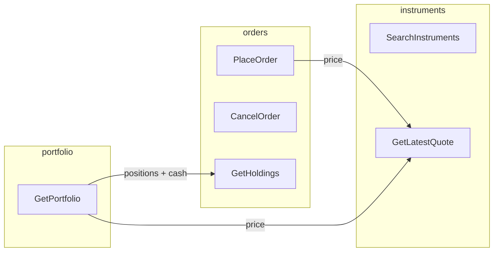

# Architecture

Hexagonal (ports & adapters) NestJS API with three modules. Arrow direction = "depends on".

## Modules



- `orders` needs the price from `instruments` (`QuoteProvider` port → `GetLatestQuote`).
- `portfolio` needs positions/cash from `orders` (`HoldingsProvider` → `GetHoldings`) and the price from `instruments` (`QuoteProvider` → `GetLatestQuote`).

## Layers (per module)

```
infrastructure → application → domain
```

- **domain** — pure types + invariants (no Nest, TypeORM, or HTTP).
- **application** — use cases; orchestrate domain + ports.
- **infrastructure** — persistence (TypeORM), HTTP controllers, adapters.

## Shared domain

Cross-cutting pure types live in `shared/domain/`:

- `currency.ts` — the `Currency` type (`ARS`, `USD`).
- `money.ts` — `toCents`/`fromCents` (pesos ↔ cents) and the `Money` value object (`{ amount, currency }`, amount in cents).
- `errors/domain.error.ts` — the `DomainError` base class.

## Ports

| Module | in-ports (offers) | out-ports (needs) |
| --- | --- | --- |
| `instruments` | `SearchInstruments`, `GetLatestQuote` | `InstrumentRepository`, `MarketDataRepository` |
| `orders` | `PlaceOrder`, `CancelOrder`, `GetHoldings` | `OrderRepository`, `QuoteProvider` |
| `portfolio` | `GetPortfolio` | `HoldingsProvider`, `QuoteProvider` |

## Caching

`GetLatestQuote` is decorated with a **cache-aside** layer (`CachedGetLatestQuote`) that
reads quotes from Redis (port `QuoteCache` → `RedisQuoteCache`) with a short TTL. On a
cache miss it falls back to the database, and a cache failure never breaks the request
(best-effort, graceful degradation).

## Database

Tables: `users`, `instruments`, `orders`, `marketdata` (see [`sql/database.sql`](../sql/database.sql) and [`data-model.md`](./data-model.md)).

`orders` is the **ledger**: positions and cash are derived from `FILLED` orders.
