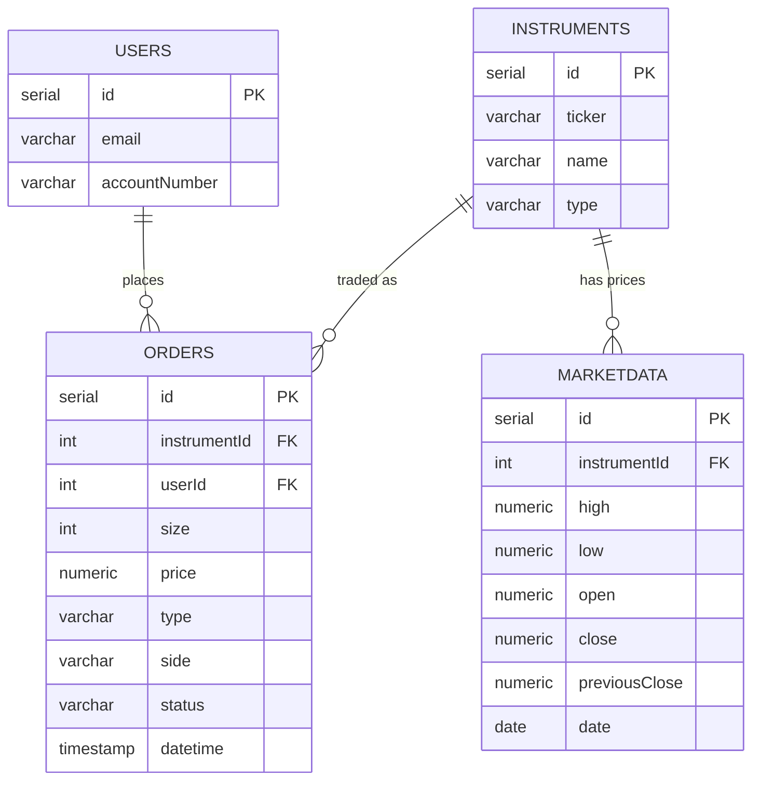

# Data model

PostgreSQL schema (SERIAL primary keys). See [`sql/database.sql`](../sql/database.sql).

## Notes

- **`size`'s meaning depends on `side`**: for `BUY`/`SELL` it is the number of shares; for `CASH_IN`/`CASH_OUT` it is the amount in ARS (with `price = 1`).
- **`instruments.type`**: `ACCIONES` (stocks) or `MONEDA` (currency). ARS is `MONEDA` (id 66).
- **`orders` is the ledger**: positions and cash are derived from `FILLED` orders (there is no materialized balance table).
- **`marketdata.date`** is `DATE` (not `datetime` as the challenge prose said).
- **Schema improvements (migrations)**: CHECK constraints on `side`/`type`/`status`, indexes on `orders.userId`, `orders.status`, `marketdata.instrumentId`.
