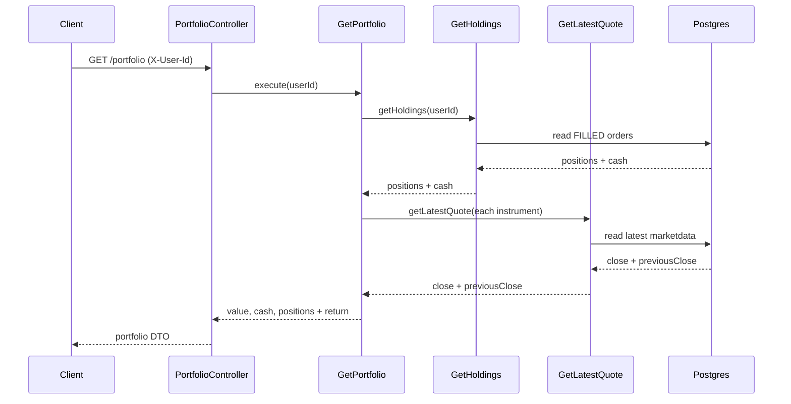
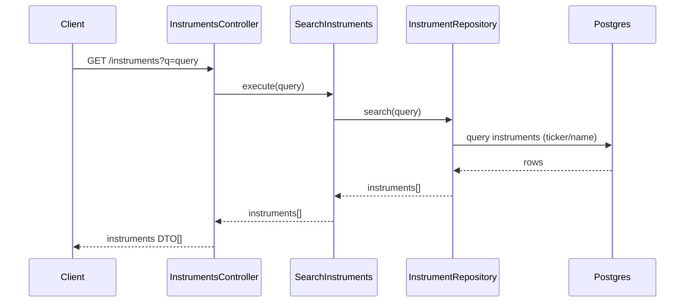
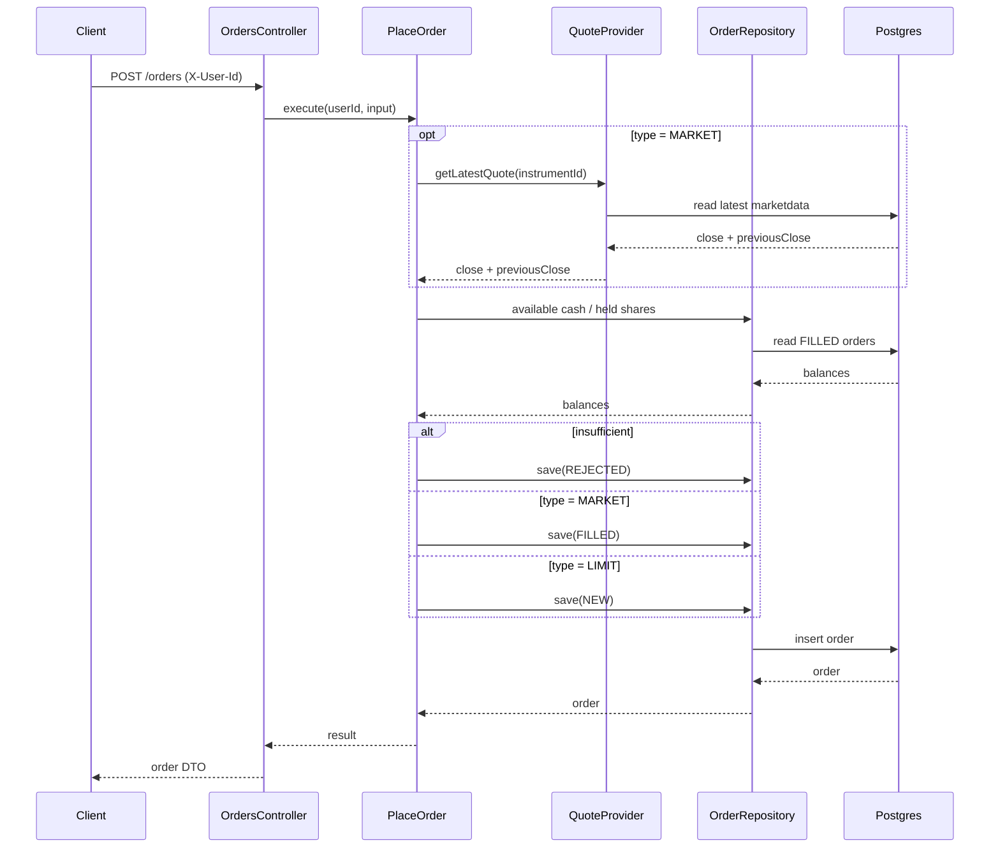
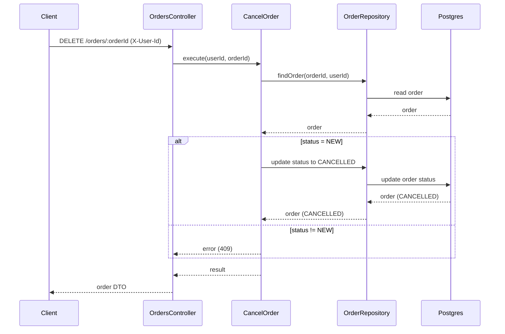

# Endpoints

The API has four endpoints: the three listed in the challenge, plus **cancel** (implied by the order lifecycle rule "only `NEW` orders can be cancelled").

There is **no authentication** (challenge scope): the user is identified by the **`X-User-Id`** header. When authentication is added later, this header is replaced by the auth token (JWT) and the routes stay the same.

| # | Method | Path | Purpose |
| --- | --- | --- | --- |
| 1 | `GET` | `/portfolio` | account value, available cash, positions |
| 2 | `GET` | `/instruments?q=` | search instruments by ticker or name |
| 3 | `POST` | `/orders` | send an order (`BUY`/`SELL`, `MARKET`/`LIMIT`) |
| 4 | `DELETE` | `/orders/:orderId` | cancel a `NEW` order |

> **Detailed sequence diagrams** (one per endpoint, through the hexagonal layers) live in
> [`sequence-diagrams/`](./sequence-diagrams/README.md).

## 1. Portfolio

Composes positions/cash (from `orders`) with prices (from `instruments`).

### Portfolio calculation

- **Available cash** = Σ `CASH_IN(size)` − Σ `CASH_OUT(size)` − Σ `BUY(size × price)` + Σ `SELL(size × price)` (from `FILLED` orders).
- **Position quantity** (per instrument) = Σ `BUY(size)` − Σ `SELL(size)` (from `FILLED` orders).
- **Market value** = quantity × `close`.
- **Return %** = `(close − previousClose) / previousClose × 100`.
- **Total account value** = available cash + Σ market values.

> **Assumption**: "rendimiento total (%)" is interpreted as the **daily return** (`close` vs `previousClose`).

## 2. Search instruments

## 3. Send order

The core flow: place an order and decide its status.

## 4. Cancel order

## Notes

- **`X-User-Id`** identifies the user (no auth). Replaced by JWT when auth is added.
- **`size` or `amount`**: the order body accepts an exact share count (`size`) or a total in ARS (`amount`); the use case computes `size = floor(amount / price)` when `amount` is given.
- **MARKET** uses the last `close`; **LIMIT** requires `price`.
- **Insufficient** → saved as `REJECTED` (BUY validates cash, SELL validates held shares).
- **Cancel** only works on `NEW` orders; otherwise it returns a conflict error (409).
- **Idempotency** → `POST /orders` accepts the `Idempotency-Key` header: if the server has already seen that key, it returns the original order instead of duplicating it.
- See [`order-lifecycle.md`](./order-lifecycle.md) for the state machine.
