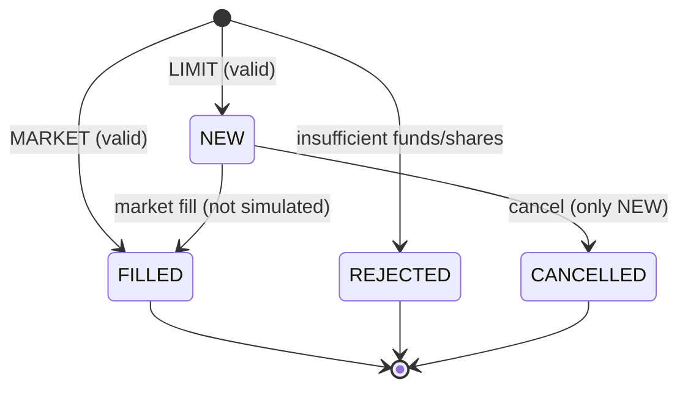

# Order lifecycle

An order represents a trade (`BUY`/`SELL`) or a cash transfer (`CASH_IN`/`CASH_OUT`). Orders are the **ledger**: positions and cash are derived from `FILLED` orders.

## Enums

### `side`

| Value | Meaning |
| --- | --- |
| `BUY` | Buy shares |
| `SELL` | Sell shares |
| `CASH_IN` | Incoming cash transfer (deposit) |
| `CASH_OUT` | Outgoing cash transfer (withdrawal) |

### `type`

| Value | Meaning | Price in request |
| --- | --- | --- |
| `MARKET` | Execute immediately at the last `close` | not sent (uses `close`) |
| `LIMIT` | Place at a given price | required |

### `status`

| Value | Meaning |
| --- | --- |
| `NEW` | A `LIMIT` order waiting in the market |
| `FILLED` | Executed |
| `REJECTED` | Rejected (e.g. insufficient funds/shares); still saved |
| `CANCELLED` | Cancelled by the user |

## State machine

## Rules

- **MARKET** → executed immediately at the last `close`, status `FILLED`. No `price` in the request.
- **LIMIT** → requires `price`, status `NEW`. It is **not** filled automatically (no market simulation).
- **Cancel** → only `NEW` orders can be cancelled (`CANCELLED`).
- **Insufficient** → the order is saved with `REJECTED`:
  - `BUY`: available cash must cover the cost (`close × size` for MARKET, `limit × size` for LIMIT).
  - `SELL`: held shares must cover `size`.
- **Quantity** → either an exact share count, or a total amount in the order's currency (`size = floor(amount / price)`, no fractional shares).
- **Transfers** → `CASH_IN`/`CASH_OUT` are `MARKET` orders on the cash instrument (ARS or USD) that fill immediately.
- **Cash** → modeled as `MONEDA` instruments: ARS (id `66`) and USD (id `67`).
- **Currency** → each instrument trades in `ARS` or `USD`; the order takes the instrument's currency. Cash is tracked per currency (no FX conversion).

## `size` semantics

The `size` column depends on `side`:

| `side` | `size` means |
| --- | --- |
| `BUY` / `SELL` | number of shares |
| `CASH_IN` / `CASH_OUT` | amount in the order's currency (with `price = 1`) |

## Notes

- `NEW` orders do **not** reserve cash or shares: available cash and held shares are computed from `FILLED` orders only.
- **Idempotency** → `POST /orders` accepts the `Idempotency-Key` header; a repeated key returns the already-placed order instead of duplicating it.
