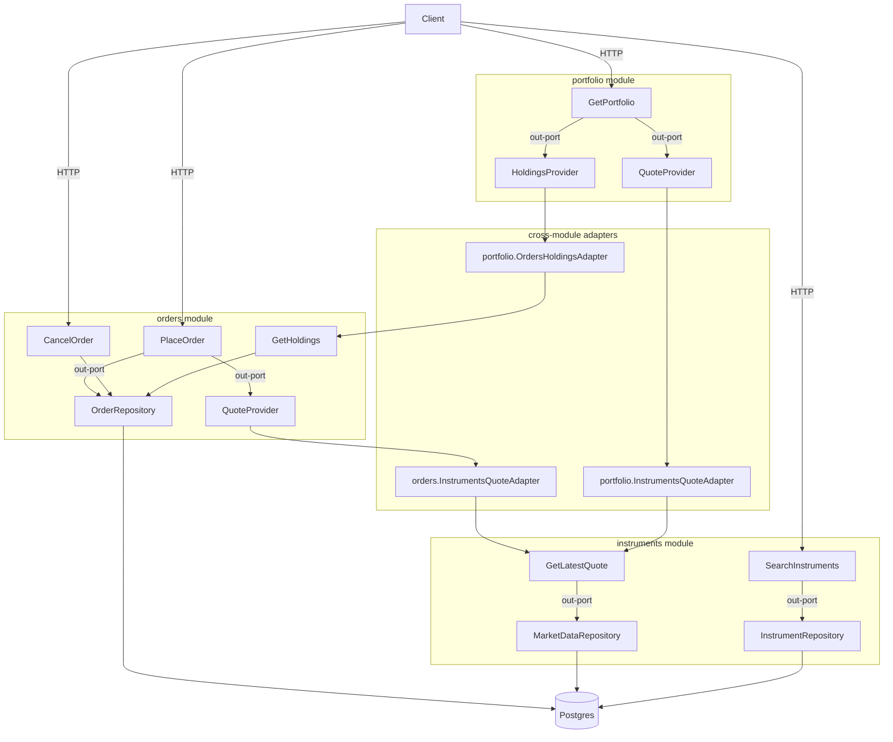

# Sequence diagrams

Execution sequence of each endpoint, walking the hexagonal layers
(`infrastructure → application → domain`). Diagrams use [Mermaid `sequenceDiagram`](https://mermaid.js.org/syntax/sequenceDiagram.html).

## Index

| Endpoint | Diagram |
| --- | --- |
| `GET /instruments?q=` | [`search-instruments.md`](./search-instruments.md) |
| `POST /orders` (MARKET) | [`place-order-market.md`](./place-order-market.md) |
| `POST /orders` (LIMIT) | [`place-order-limit.md`](./place-order-limit.md) |
| `DELETE /orders/:orderId` | [`cancel-order.md`](./cancel-order.md) |
| `GET /portfolio` | [`get-portfolio.md`](./get-portfolio.md) |
| — (concurrency) | [`concurrency-lock.md`](./concurrency-lock.md) |

> `GetLatestQuote` (internal `instruments` use case) and `GetHoldings` (`orders`) have no
> HTTP endpoint of their own: they appear inside the `POST /orders` and `GET /portfolio`
> flows as cross-module calls through adapters.

## System overview

- `orders` needs the price → `QuoteProvider` port → `orders.InstrumentsQuoteAdapter` → `GetLatestQuote`.
- `portfolio` needs positions/cash → `HoldingsProvider` → `portfolio.OrdersHoldingsAdapter` → `GetHoldings`;
  and the price → `QuoteProvider` → `portfolio.InstrumentsQuoteAdapter` → `GetLatestQuote`.
- Cross-module access is **only** through in-ports, never through internal imports or shared tables.

## Legend / conventions

| Symbol | Meaning |
| --- | --- |
| `->>` | call / request (solid arrow) |
| `-->>` | return (dashed arrow) |
| `alt` / `opt` / `loop` / `par` | Mermaid conditional/loop/parallel regions |
| `Note over X, Y` | comment about that stretch |

### Actors

- **Client** — HTTP (headers `X-User-Id` and `Idempotency-Key`).
- **Controller** — `infrastructure/http`; validates the DTO, converts money, maps to the output DTO.
- **UseCase** — `application`; orchestrates domain + `out` ports.
- **Adapter** — `infrastructure`; implements an `out` port by talking to **another module** (anti-corruption).
- **Repository** — `infrastructure/persistence` (TypeORM); implements an `out` port against Postgres.
- **Postgres** — the database.

### Money

- Everything in **domain** and **application** is in **cents (integer)**.
- The pesos ↔ cents conversion happens only at two edges:
  - Input controller: `toCents(amount|price)`.
  - Persistence mapper / output DTO: `toCents`/`fromCents`.
- `fromCents` **rejects negatives** (positive magnitudes): the sign is decided by the operation.

### Ports (dependency rule)

- `application` depends on `out` ports (`Symbol`), not on implementations.
- The real implementation is injected via DI (`{ provide: TOKEN, useClass: Impl }`).
- Cross-module: `orders → instruments` and `portfolio → orders/instruments` go through **adapters**,
  never through internals or shared tables.
