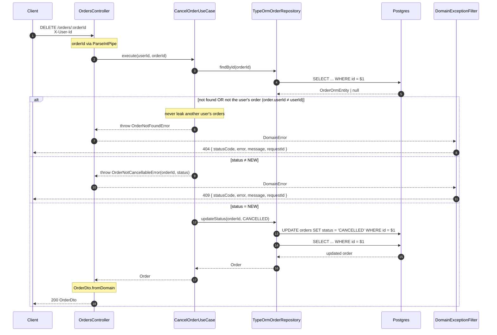

# `DELETE /orders/:orderId` — cancel

Cancels an order: only `NEW → CANCELLED`. Domain errors → envelope via `DomainExceptionFilter`.

## Notes

- **`order.userId ≠ userId` is treated as `404`** (not `403`): it must not reveal the existence
  of other users' orders.
- `OrderNotCancellableError` applies only to states other than `NEW`.
- The `DomainError.code → HTTP` mapping is resolved by the global filter, not by the controller.
