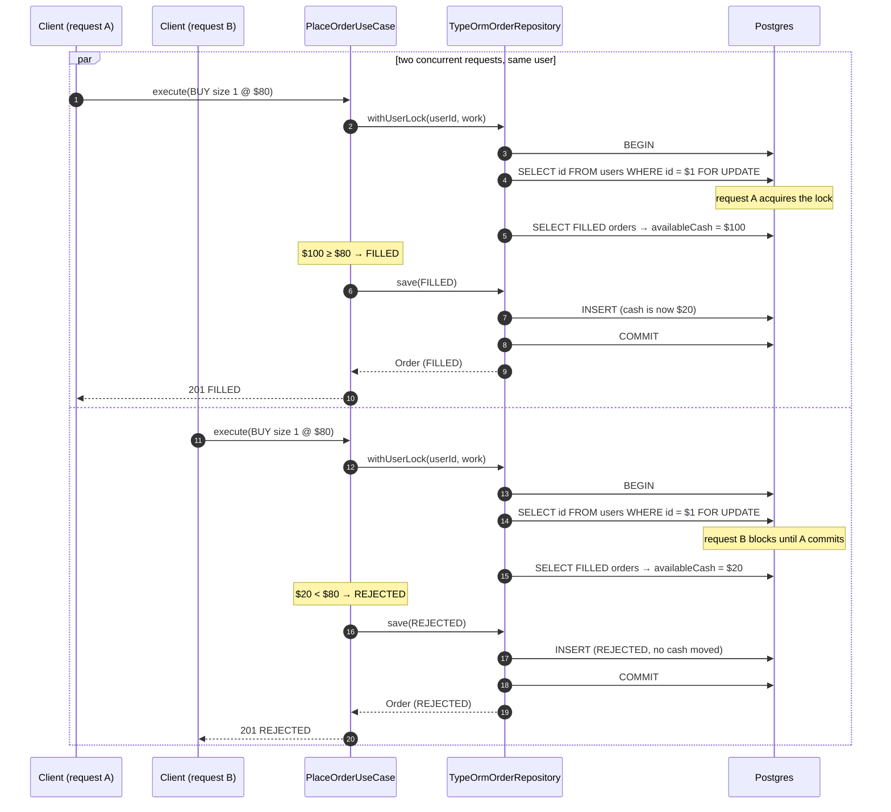

# Concurrency — per-user pessimistic lock

Two `MARKET` orders from the **same user** arriving at the same time. Without the lock,
both would read `$100` cash and spend `$80` each → overdraft. `SELECT ... FOR UPDATE`
serializes them; the second one reads the updated cash and gets `REJECTED`.

## Notes

- The invariant is **per user** ("never go negative, never sell what you don't own"). Locking
  the `users` row serializes all of that user's order placements; different users never block
  each other.
- `withUserLock` is an `OrderRepository` port: the use case does not know *how* the lock is
  implemented. Extracting `orders` to its own service only swaps the lock implementation
  (e.g. `pg_advisory_xact_lock(userId)`), not `PlaceOrder`.
- This is exactly what the e2e concurrency test covers: two simultaneous orders → one `FILLED`
  + one `REJECTED`.
