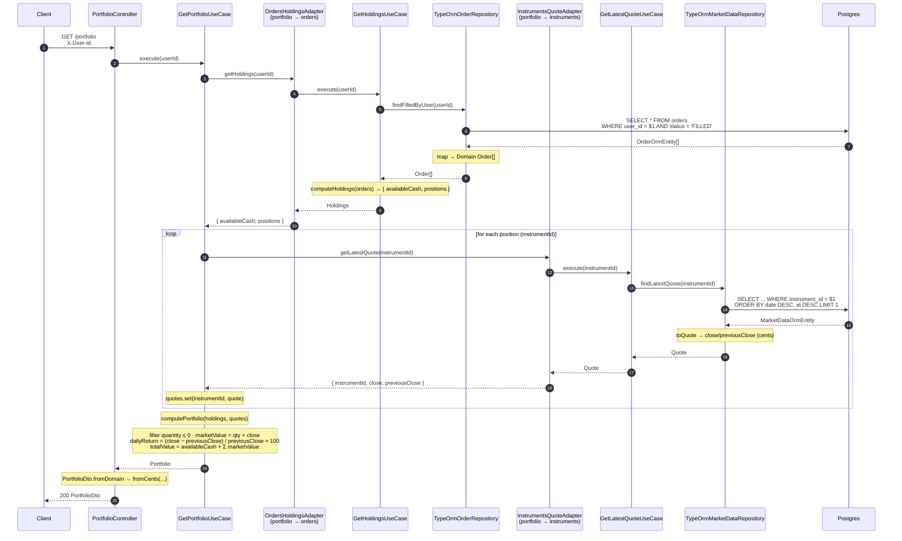

# `GET /portfolio` — account valuation

Builds the portfolio: cash plus positions with market value and daily return. Combines
`orders` (holdings) and `instruments` (quotes) through cross-module adapters.

## Notes

- **Two dependencies** (`HoldingsProvider` and `QuoteProvider`), both satisfied by adapters
  toward `orders` and `instruments`. The `portfolio` domain does not know those modules.
- **`quantity ≤ 0` is filtered**: the "short" in the seed (instrument 31, `BUY 20 − SELL 30 = −10`)
  is excluded from the valuation (positions you don't own are not shown).
- **`dailyReturn`** is daily (`close` vs `previousClose`), in %, rounded to 2 decimals.
  `previousClose = 0` → return `0` (no division by zero).
- N+1 quotes: one query per position; acceptable at this size (see `interview-prep.md §2`
  for the composite index and read-model as the evolution path).
