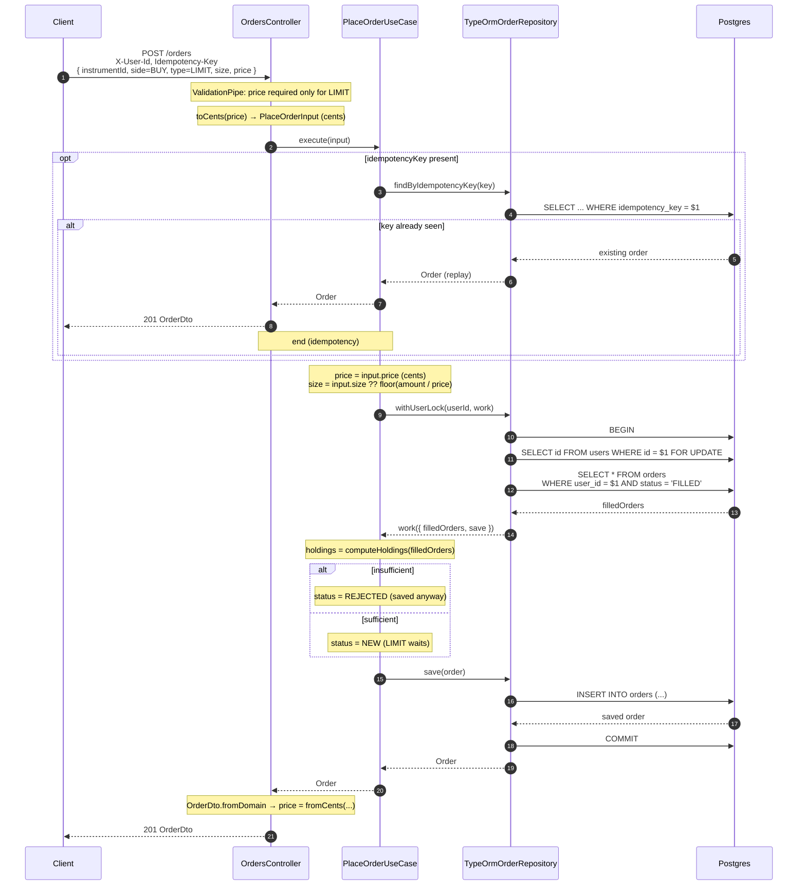

# `POST /orders` — LIMIT

A `LIMIT` order requires `price` and stays `NEW` (it is not executed on its own). If there
aren't enough funds/shares it ends `REJECTED`. It does not query a quote: it uses the
request `price`.

## Notes

- **`LIMIT` does not reserve** cash or shares: available cash and held shares are computed
  only from `FILLED` orders. The sufficiency check here is "at placement time", not a hard reserve.
- **`NEW` → `CANCELLED`** is the only later path (see [`cancel-order.md`](./cancel-order.md)).
  There is no execution simulation (`NEW → FILLED` does not happen in the MVP).
- The per-user lock still applies: two simultaneous `LIMIT` orders from the same user are serialized too.
