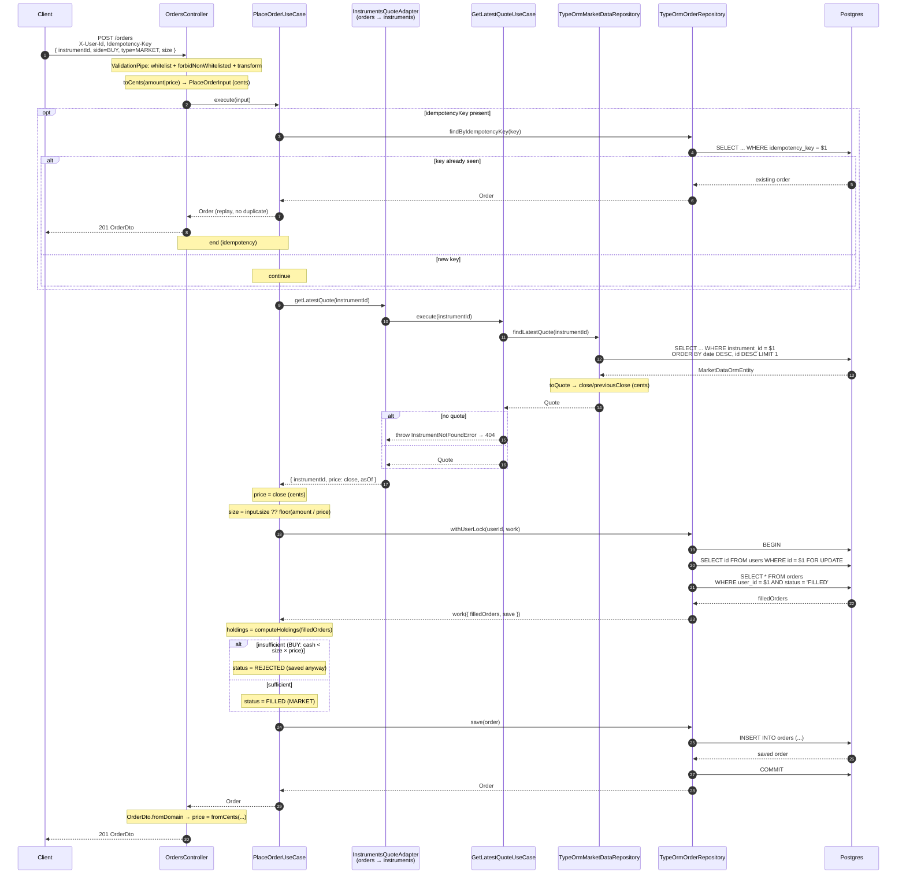

# `POST /orders` — MARKET

A `MARKET` order executes immediately at the last `close`. It ends `FILLED` or `REJECTED`
(insufficient funds/shares), and in both cases **it is saved**. Includes idempotency, a
cross-module quote, and the per-user pessimistic lock.

## Notes

- **Price**: `MARKET` does not take `price` in the request; it uses the `close` from `marketdata`.
- **Lock**: `SELECT ... FOR UPDATE` on `users` serializes the orders of **one** user
  (closes the read→validate→write race). Different users never block each other.
- **Derived**: sufficiency is computed with `computeHoldings` over the `FILLED` orders
  (there is no materialized balance column).
- **`REJECTED` is not thrown**: it is a use-case *outcome* that gets saved; only invariants
  (unknown instrument, etc.) throw a `DomainError`.
