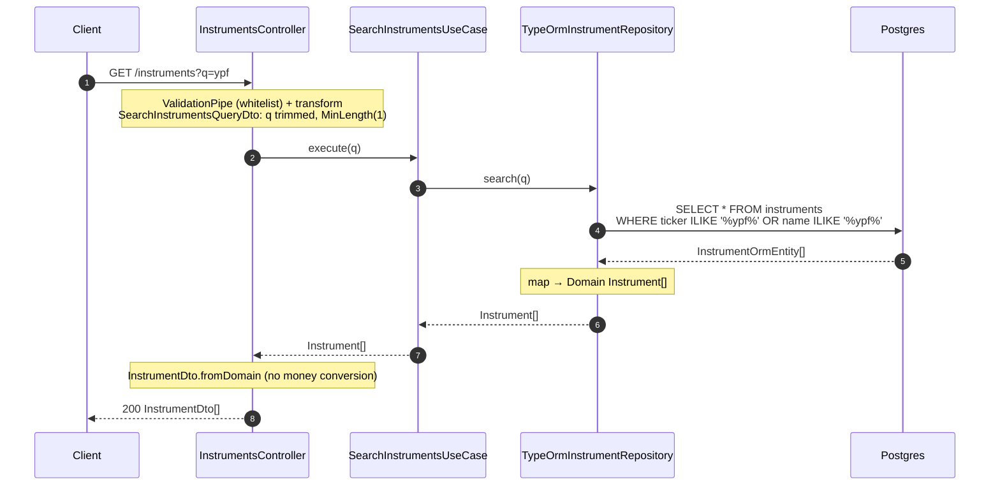

# `GET /instruments?q=` — search

Searches instruments by `ticker` or `name` (partial, case-insensitive).

## Notes

- `SearchInstrumentsUseCase` is a passthrough: no business rules, it just delegates to the
  `out` port `InstrumentRepository`.
- The search is an `OR` between `ticker` and `name`, using `ILIKE` (case-insensitive).
